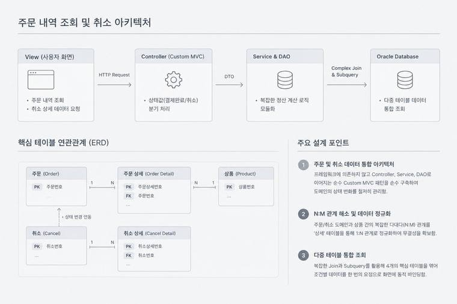
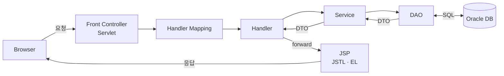
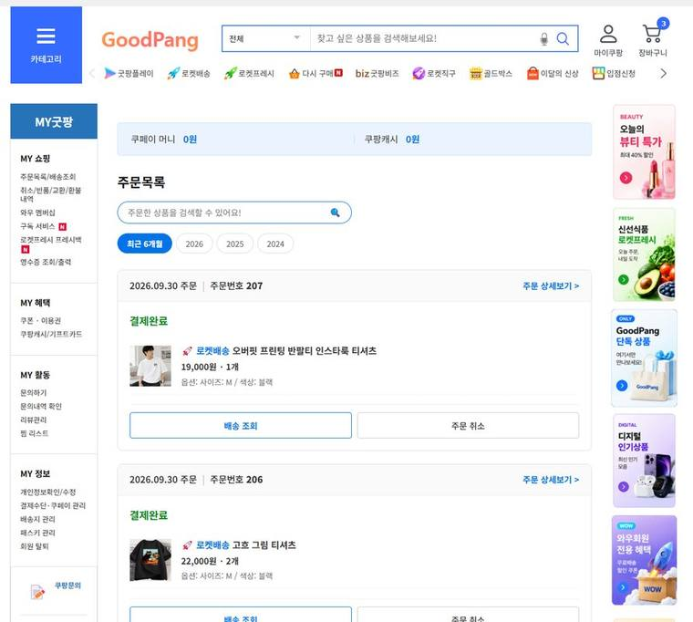
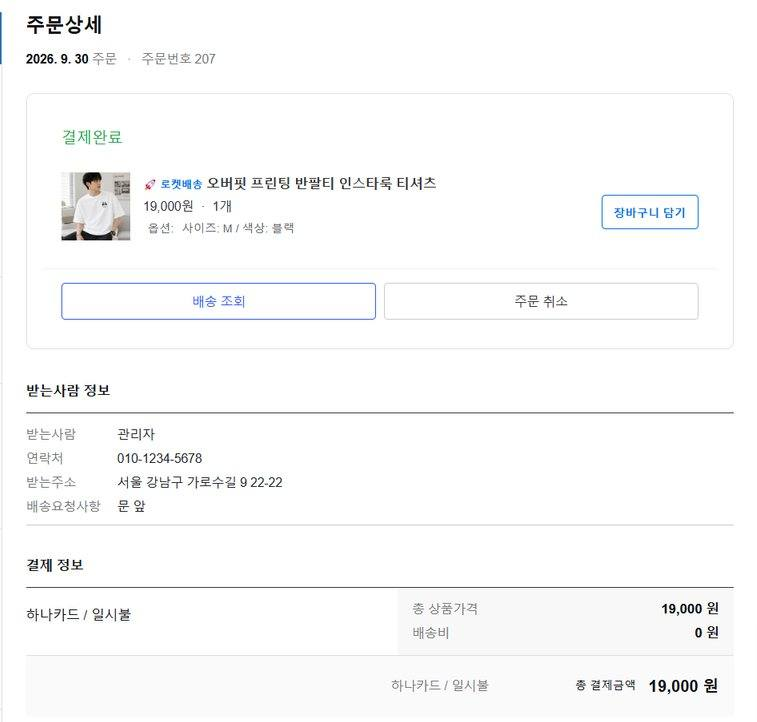
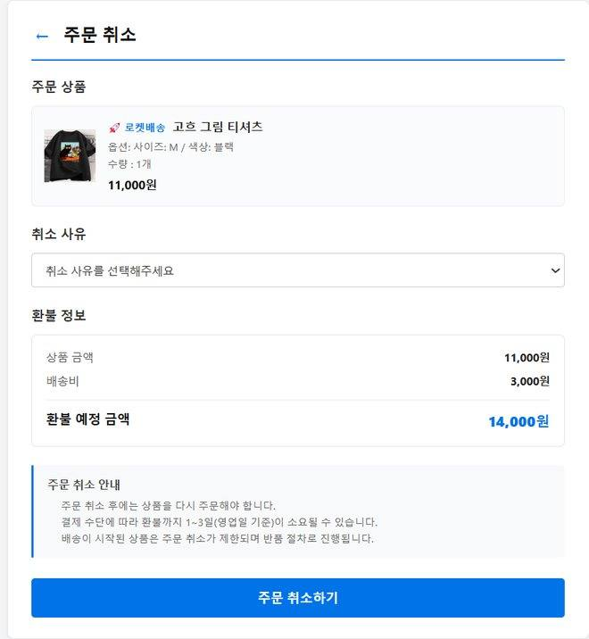
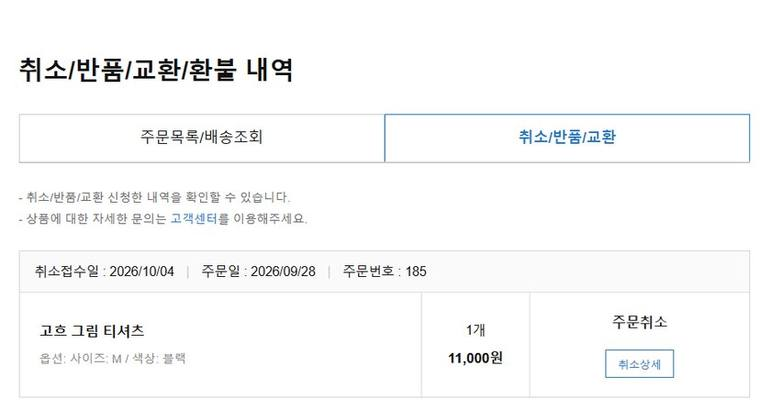
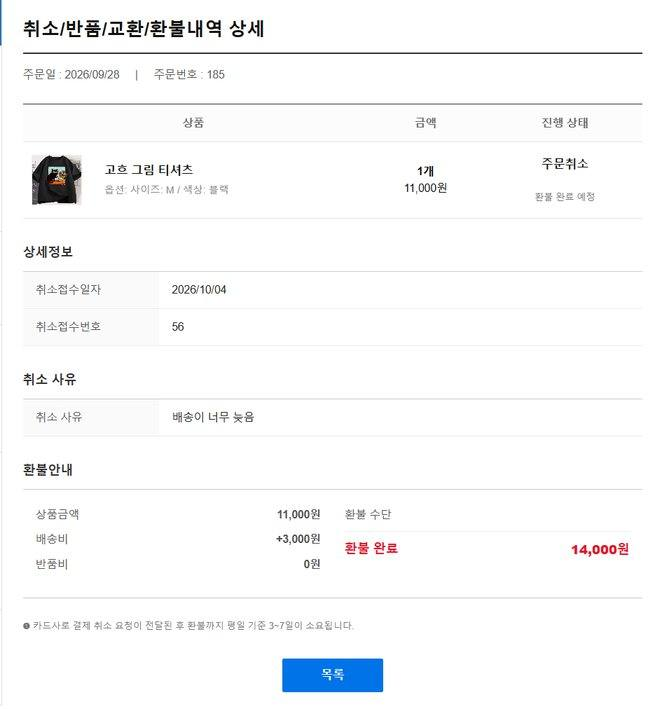
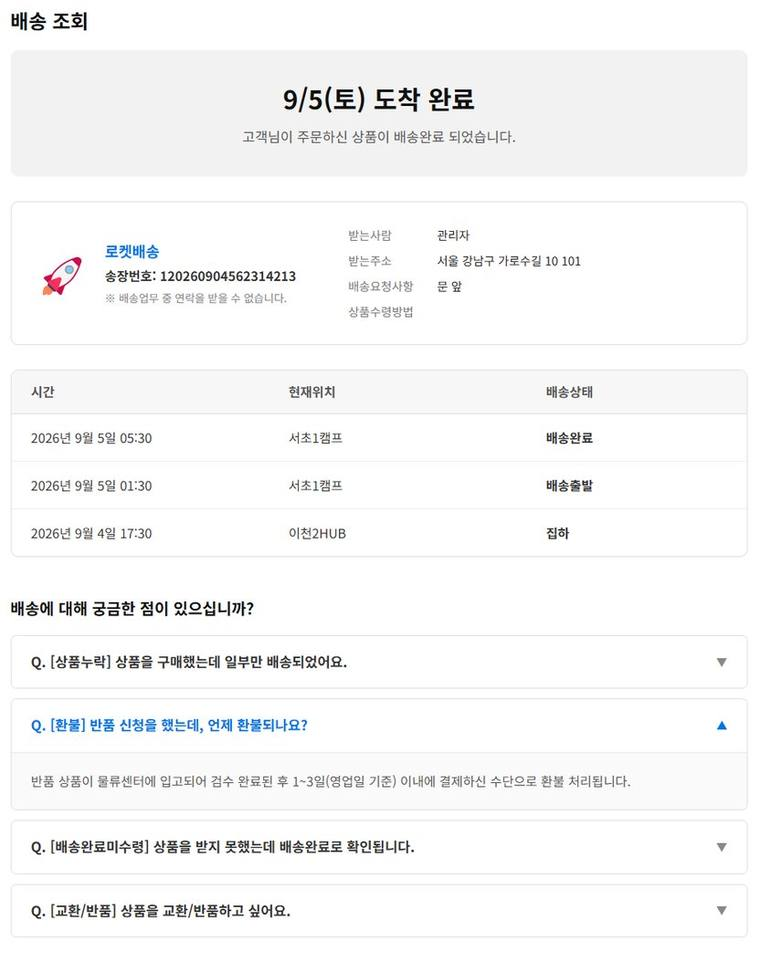

<div align="center">

# 🛒 GoodPang (굿팡)

**쿠팡을 벤치마킹한 MVC 아키텍처 기반 이커머스 웹 서비스**


</div>

<br>

## 📌 프로젝트 소개

회원가입·로그인, 상품 검색, 장바구니, 주문·결제, 마이페이지 등 이커머스의 핵심 기능을 구현한 팀 프로젝트입니다.<br>
Spring 같은 프레임워크 없이 **순수 Java/JSP로 Front Controller와 Handler Mapping을 직접 구성**하고, Servlet · Service · DAO · DTO로 역할을 나눠 MVC 구조를 구현했습니다.

| 항목 | 내용 |
|---|---|
| 기간 | 2026.08.10 ~ 2026.09.04 (4주) |
| 인원 | 4명 |
| 과정 | 쌍용교육센터 Java Full-Stack 개발자 양성 과정 팀 프로젝트 |

<br>

## 🛠 개발 환경

| 구분 | 기술 |
|---|---|
| Backend | Java, Servlet, JSP, JDBC |
| Frontend | HTML5, CSS3, JavaScript, jQuery, AJAX |
| Database | Oracle DB |
| WAS | Apache Tomcat |
| Tool | Eclipse, SQL Developer, Git, GitHub |
| OS | Windows, Linux (Ubuntu) |

<br>

## 🏗 시스템 아키텍처



<details>
<summary>요청 처리 흐름 다이어그램</summary>



</details>

<br>

## 🙋‍♀️ 담당 역할 (오수빈)

### 1. 주문 내역 및 상세 조회
- JOIN과 서브쿼리로 주문 상품, 결제 금액, 배송 상태를 조회하는 DAO와 서비스 로직 구현
- 한 페이지에 최대 3건의 주문 출력, 같은 주문번호의 여러 상품은 한 주문 카드 안에 묶어 표시

| 주문 목록 | 주문 상세 |
|---|---|
|  |  |

### 2. 조건별 주문 검색
- 주문 상태(진행 / 취소 / 완료)와 조회 기간으로 결과를 필터링하는 Servlet 핸들러 및 DAO 로직 구현

### 3. 주문 취소 내역 조회
- `PRODUCT_RETURN` 테이블을 INNER JOIN해 실제 취소 신청이 완료된 건만 조회
- Oracle `ROWNUM` 서브쿼리로 페이지당 5건씩 조회
- 환불 완료 예정일 컬럼(`expected_cancel_date`)을 설계하고 JSTL `<fmt:formatDate>`로 `M/dd(E)` 형식 표시
- 카드사·은행 코드를 SQL `CASE WHEN`으로 '비씨카드', '신한은행' 등 한글 명칭으로 변환해 DTO에 바인딩

| 주문 취소 | 취소 내역 | 취소 상세 |
|---|---|---|
|  |  |  |

### 4. 배송 조회
- 배송 상태, 도착 완료일, 송장번호, 회원 정보를 조회
- 마이페이지 주소가 아닌 주문 시점 스냅샷 테이블 `ORDER_ADDRESS`를 조인해 주소 변경으로 인한 데이터 오염 방지
- `<c:forEach>`로 배송 현황(시간 · 위치 · 상태)을 최신순 3열 리스트로 출력



### 5. 공통 디자인
- 프로젝트 로고, 배너 리소스, 파비콘 제작 및 적용


<br>

## 🔥 트러블 슈팅

<details>
<summary><b>01. 주문 금액 계산 오류 및 중복 합산</b></summary>
<br>

**문제**<br>
한 주문에 여러 상품(옵션)이 있거나 수량이 2개 이상이면 개별 상품 금액이 잘못 계산되고, 전체 주문 금액이 2~3배로 출력됨

**해결**<br>
`ORDERS.TOTAL_PRICE`는 주문 1건의 총액으로만 사용하고, 개별 상품 금액은 `ORDER_DETAIL`의 `item_price × quantity`로 계산하도록 역할을 분리

</details>

<details>
<summary><b>02. 1:N JOIN 시 주문 카드 단위 페이징 잘림</b></summary>
<br>

**문제**<br>
`ORDERS`와 `ORDER_DETAIL`을 조인한 뒤 `ROWNUM`으로 페이징하면서, 주문 건수가 아닌 상품 행(Row) 수를 기준으로 데이터가 잘림

**해결**<br>
서브쿼리로 주문번호를 먼저 페이지 단위로 거른 뒤 상세 데이터를 조인하는 3중 서브쿼리 페이징 도입

</details>

<details>
<summary><b>03. 조건부 배송비(19,800원 기준) 중복 부과</b></summary>
<br>

**문제**<br>
상품별 반복문(`c:forEach`) 안에서 배송비가 계산되어 상품마다 배송비 3,000원이 중복 표시되고, 총액에서 배송비를 뺄 때 마이너스 연산 오차 발생

**해결**<br>
주문 대표 객체(`orderInfo`) 단위로 로직을 일원화하고, 총액 판별 조건을 DAO에 반영해 배송비가 주문당 1회만 계산되도록 개선

</details>

<br>

## 📁 프로젝트 구조

```
GoodPang
├── project/GoodPang/      # 웹 서비스 소스 (Servlet · Service · DAO · DTO · JSP)
├── docs/                  # 설계 문서, ERD, SQL, API 문서
├── cicd/                  # 배포 · 재시작 스크립트
├── GoodPang/              # Android 앱 (Kotlin)
└── old_project/           # 사전 Oracle DB 팀 프로젝트 (테이블 설계 · 쿼리)
```

<br>

## 📄 문서

- [관리자(/admin) URL 목록](docs/관리자_URL_목록.md)
- [배송 JSON API](docs/배송_JSON_API.md)
- [배포 구성](cicd/README.md)
